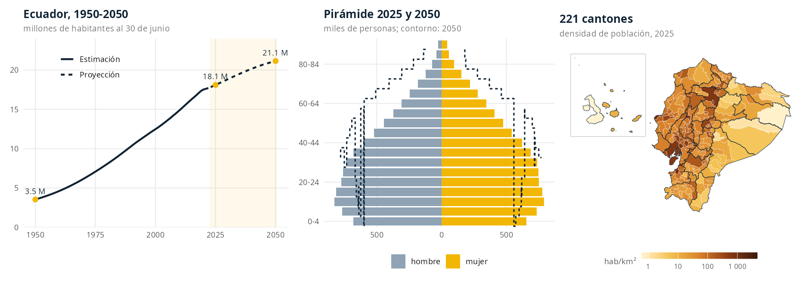
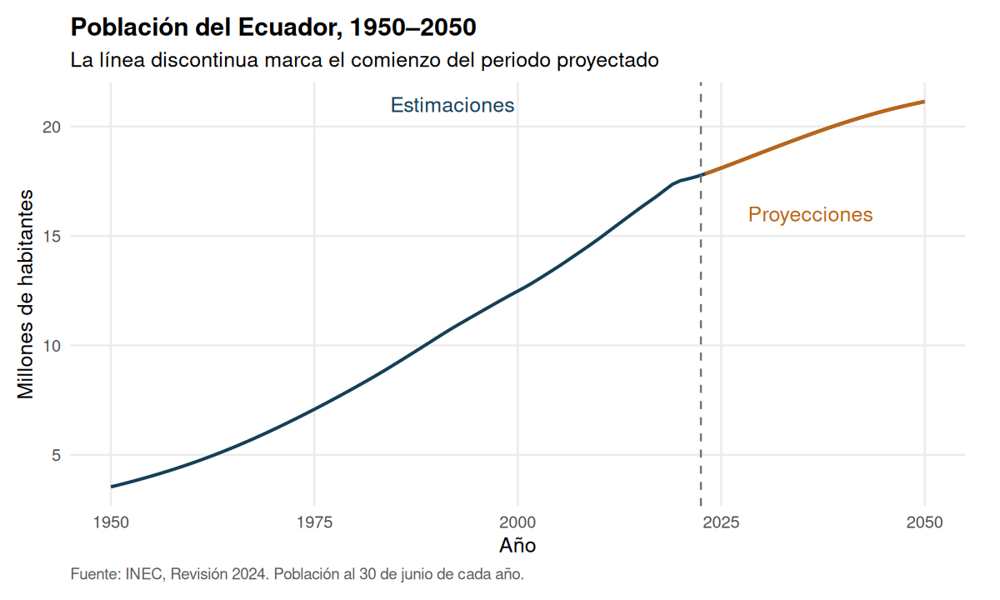
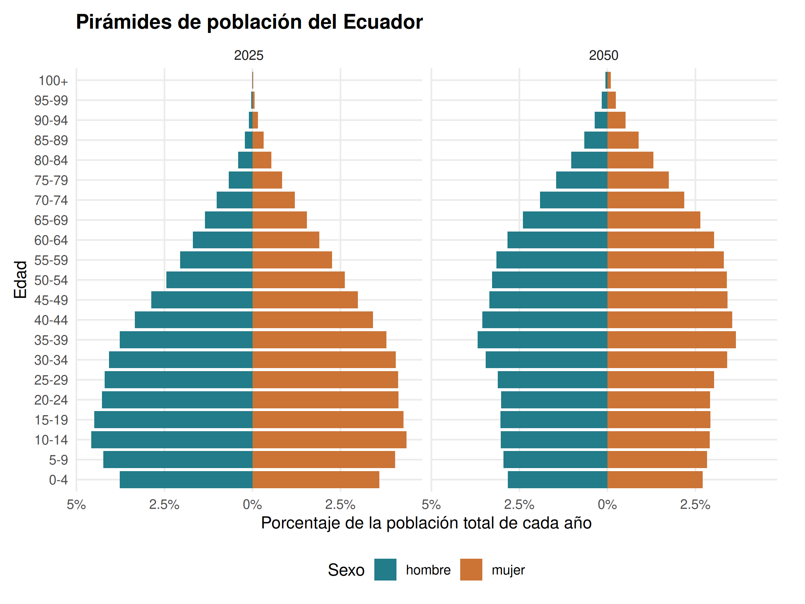
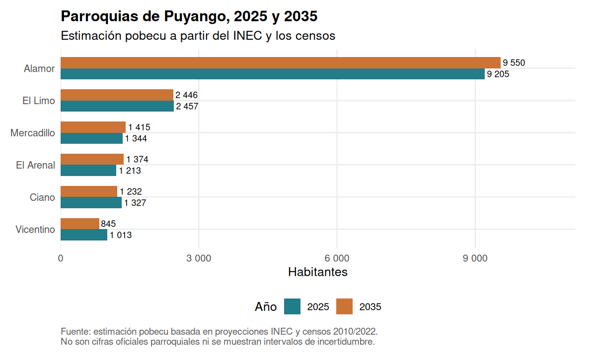
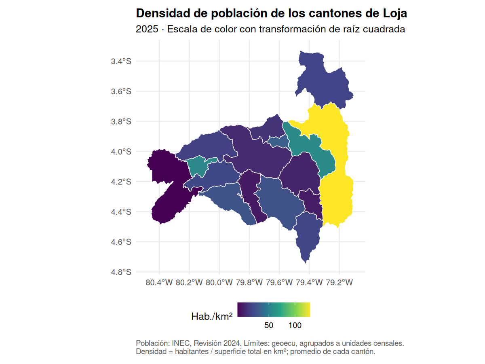
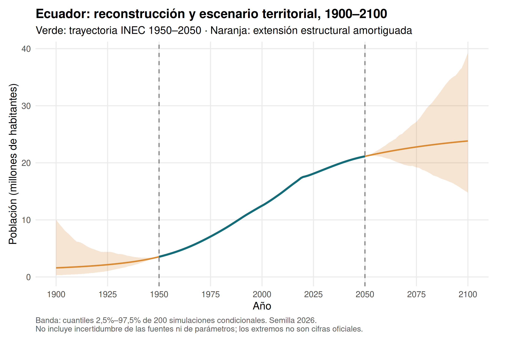

# pobecu 

**Population of Ecuador by province, canton and parish, ready to analyse in R.**

[Español](README.md) · **English**

[](https://github.com/f-slg/pobecu/actions/workflows/R-CMD-check.yaml)
[](https://f-slg.github.io/pobecu/)
[](https://github.com/f-slg/pobecu/blob/main/LICENSE.md)

> **About the language.** This is a shortened translation of the Spanish
> README, which is generated from
> [README.Rmd](https://github.com/f-slg/pobecu/blob/main/README.Rmd) and shows
> the real R output of every example. The package is aimed at users in Ecuador
> and Latin America: function names, arguments, column names, messages and the
> vignettes are in Spanish. See the [glossary](#glossary) below.

**pobecu** provides population denominators by year, sex, age and urban/rural
area of residence, identified by the codes of Ecuador's
Political-Administrative Division (DPA). Use it to compute rates and coverage
indicators and to build maps together with the sister package
[geoecu](https://f-slg.github.io/geoecu/).

This is an independent package. National, provincial and cantonal figures come
from **INEC** (National Institute of Statistics and Censuses), **Revision 2024,
updated with areas in 2025**. Parish figures are **pobecu's own estimates**, not
official INEC projections.



## Coverage

| Level | Years | Age | Urban/rural | Nature |
|---|---|---|---|---|
| National | 1950–2050 | Single years or 5-year groups, up to 100+ | 2010–2035 | INEC |
| Province | 1990–2035 | Single years or 5-year groups, up to 100+ | 2010–2035 | INEC |
| Canton | 2010–2035 | Single years or 5-year groups, up to 100+ | 2010–2035 | INEC |
| Parish | 2010–2035 | 5-year groups, up to 85+ | Not available | pobecu estimate |

`anio` (year) refers to **30 June**. Figures up to 2022 are demographic
estimates; from 2023 onwards they are projections. The 2022 figures are not the
census count.

## Installation and first query

```r
install.packages("remotes")
remotes::install_github("f-slg/pobecu")

# For the plots and maps in this guide
install.packages(c("ggplot2", "scales", "geoecu", "sf"))
```

```r
library(pobecu)

poblacion("nacional", anio = c(2022, 2025, 2030))
pob_fuentes()                                   # available coverage
```

## Querying territories and years

Names are matched ignoring case and accents, and numeric codes recover their
leading zeros. For repeated names (e.g. Bolívar, Olmedo) also give the
province or use the DPA code.

```r
poblacion("provincia", anio = 2025)
poblacion("canton", anio = 2025:2026, canton = "loja", sexo = TRUE)
buscar_pob("olmedo", nivel = "canton")
poblacion("canton", anio = 2025, provincia = "Loja", canton = "Olmedo")
```

`sexo = FALSE` adds up men and women, `edad = NULL` adds up all ages and
`anio = NULL` returns every available year.



## Ages, groups and pyramids

| `edad` | Returns | Data needed |
|---|---|---|
| `NULL` | All ages combined | Included |
| `"quinquenal"` | 0–4, 5–9, …, 100+ (parishes up to 85+) | Included |
| `"simple"` | 0, 1, 2, …, 100 (100 means 100+) | One-time download |
| `"etapas"` | Life stages: 0–11, 12–17, 18–29, 30–64, 65+ | One-time download |
| `c(0, 5, 15, 65)` | 0–4, 5–14, 15–64, 65+ | Included |
| `c(0, 1, 5)` | 0, 1–4, 5+ | One-time download |

Breaks are the **start** of each group; the last group is open-ended.

```r
poblacion("canton", anio = 2026, canton = "Loja", edad = c(0, 1, 5))
poblacion("provincia", anio = 2030, provincia = "Pichincha", edad = "etapas")
poblacion("provincia", anio = 2025, provincia = c("Guayas", "Pichincha"), area = TRUE)
```



## Joining denominators and computing rates

The numerators below are **made up** for learning purposes; the denominators
are INEC figures. Numerator and denominator must refer to the same territory,
period, sex and age group.

```r
casos <- data.frame(dpa_canton = c(1101, 1102, 701), anio = 2025,
                    casos = c(120, 8, 40))
pob_tasa(casos, "casos", por = 100000)          # cases per 100,000

# Sex-specific rates: ask for the breakdown explicitly
casos_sexo <- data.frame(dpa_provin = "11", anio = 2025,
                         sexo = c("hombre", "mujer"), casos = c(10, 14))
pob_tasa(casos_sexo, "casos", nivel = "provincia", sexo = TRUE)

# Coverage among children under one year
vacunas <- data.frame(dpa_provin = c("01", "11"), anio = 2025,
                      edad = "0", vacunados = c(11800, 6900))
cobertura <- pob_unir(vacunas, nivel = "provincia", edad = "simple")
cobertura$cobertura_pct <- 100 * cobertura$vacunados / cobertura$poblacion
```

`pob_unir()` adds the `poblacion` column; `pob_tasa()` also adds `tasa`. Both
keep the original row order and codes. Unmatched codes give `NA` with a
warning, and a zero denominator gives `NA` (not `Inf` or `NaN`). Do not add or
average rates: add the cases and compatible denominators first.

## Parishes: estimate and consistency

The package covers **1,042 units of the 2022 Census**: 221 cantonal seats and
821 rural parishes (urban parishes are grouped into the cantonal seat, code
suffix `50`). The official cantonal projection is distributed among parishes
using their shares in the 2010 and 2022 censuses (logit extrapolation), and sex
and age are adjusted by iterative proportional fitting (IPF) from the 2022
census structure. Parish figures always add up exactly to the official canton
total; that proves accounting consistency, **not** the accuracy of each parish.

```r
poblacion("parroquia", anio = c(2025, 2035), canton = "Puyango")
```



## Territorial codes and maps with geoecu

`geoecu` (≥ 0.4.0) uses the CONALI 2026 DPA, while `pobecu` uses 2022 Census
units. Before joining cases with population, convert and **aggregate** the
codes:

```r
homologar_parroquia(c("010101", "010115", "010151", "131251"))
homologar_canton(c("0809", "1413"))

# Population density: geoecu boundaries grouped to census units
mapa <- pob_mapa("canton", anio = 2025, provincia = "Loja")
ggplot2::ggplot(mapa) + ggplot2::geom_sf(ggplot2::aes(fill = densidad))
```



## Offline use

```r
poblacion("nacional", anio = 2025, edad = "simple")   # download once
pobecu_cache_dir()
pobecu_datos_disponibles()
pobecu_usar_carpeta("path/to/my_data")                # or set POBECU_CARPETA
```

## Audited against the INEC spreadsheets

[`validacion/`](https://github.com/f-slg/pobecu/tree/main/validacion) contains a
reproducible audit that reads the original INEC Excel files with a reader
independent of the one used to build the package. More than **six million
cells** — every single-year and five-year age group at the three official
levels, sex and area totals, the 2010 and 2022 census counts of the 1,042
parishes and the parish-to-canton sums — match with **zero differences**.

## Reconstruction and scenarios 1900–2100 (in development)

`pob_ajustar()` and `pob_estimar()` extend the **annual totals** of the
country, its 24 provinces, 221 cantons and 1,042 parish units to 1900–2100.
They use damped local linear trend models (`stats::StructTS`, maximum
likelihood) on log national totals and centred log-ratio territorial shares,
a top-down hierarchical distribution that keeps every level coherent, and
conditional Monte Carlo bands. Reference values are preserved exactly.

```r
modelo <- pob_ajustar(ventana = 20, phi_total = 0.98, phi_partes = 0.95)
escenarios <- pob_estimar(nivel = "todos", anio = 1900:2100, modelo = modelo,
                          simulaciones = 200, semilla = 2026)
```



> **Interpretation.** The 1900 end is a reconstruction on 2022 Census units,
> not a claim about historical jurisdictions; the 2100 end is a scenario
> conditional on assumptions, not an official projection or a validated
> forecast. Bands exclude parameter, source and territorial-change uncertainty.
> The full model description, sensitivity analysis and temporal validation are
> in the [Spanish README](README.md#13-reconstrucción-y-escenarios-de-población-19002100).

## Glossary

| Spanish | English |
|---|---|
| `poblacion()` | query population |
| `pob_fuentes()` | available sources and coverage |
| `buscar_pob()` | search the pobecu catalogue by name |
| `pob_unir()`, `pob_tasa()` | join denominators / compute rates |
| `pob_mapa()` | map with population and density (needs geoecu) |
| `homologar_parroquia()`, `homologar_canton()` | convert CONALI 2026 codes to 2022 Census units |
| `agrupar_unidades()`, `agrupar_cabeceras()` | convert a geoecu layer to 2022 Census units |
| `pob_ajustar()`, `pob_estimar()` | fit the scenario model / estimate 1900–2100 |
| `nivel = "nacional" / "provincia" / "canton" / "parroquia"` | national / province / canton / parish |
| `anio`, `sexo`, `edad`, `area` | year, sex, age, urban/rural area |
| `hombre`, `mujer`, `urbana`, `rural` | male, female, urban, rural |
| `casos`, `tasa`, `por` | cases, rate, rate base (e.g. 100,000) |

## Methodology, citation and contributing

- [Methodology vignette](https://f-slg.github.io/pobecu/articles/metodologia.html) and [maps with geoecu](https://f-slg.github.io/pobecu/articles/pobecu-geoecu.html) (Spanish).
- Primary sources: [INEC population estimates and projections](https://www.ecuadorencifras.gob.ec/proyecciones-poblacionales/) and the [2022 Census population structure](https://www.censoecuador.gob.ec/wp-content/uploads/2024/04/01_2022_CPV_Estructura_poblacional.xlsx).
- Cite with `citation("pobecu")`. When using parish data, state that they are
  pobecu estimates and also cite the INEC census and cantonal projections.

Bugs and proposals are welcome in [Issues](https://github.com/f-slg/pobecu/issues),
in English or Spanish. See the
[contributing guide](https://github.com/f-slg/pobecu/blob/main/.github/CONTRIBUTING.md)
and the [code of conduct](https://github.com/f-slg/pobecu/blob/main/.github/CODE_OF_CONDUCT.md).
Code under the [MIT](https://github.com/f-slg/pobecu/blob/main/LICENSE.md)
licence; data from INEC publications.
