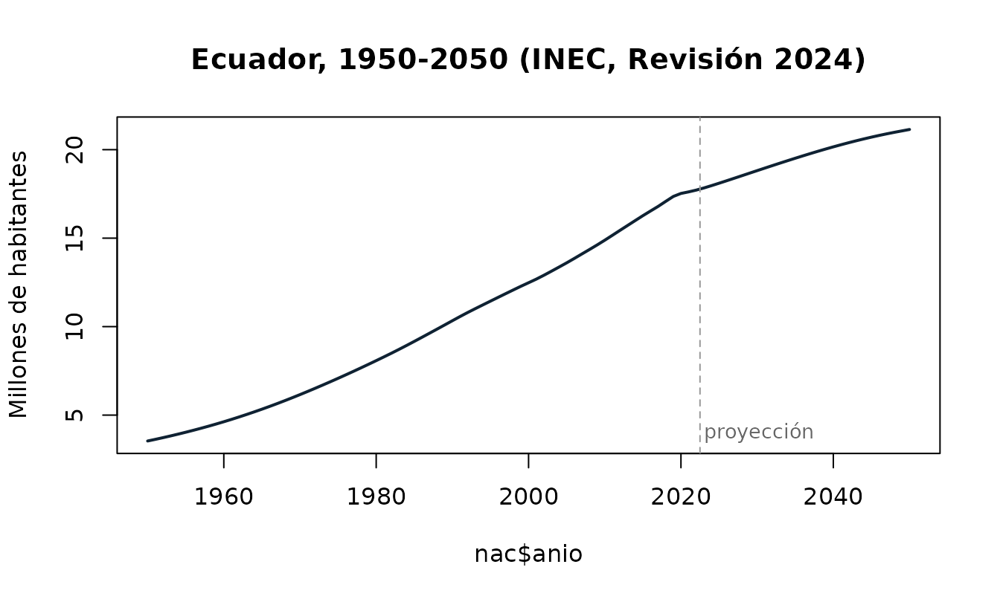
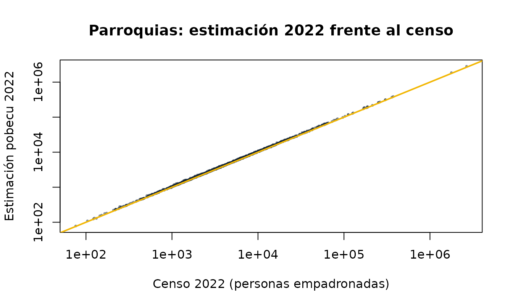
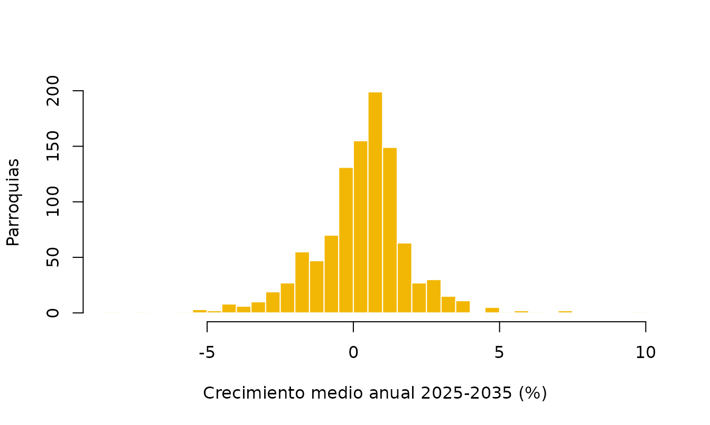

# Metodología: fuentes, proyecciones y estimación parroquial

Esta viñeta explica de dónde salen las cifras de pobecu, qué hace el
INEC para producir sus estimaciones y proyecciones, y cómo construye
pobecu la estimación parroquial, que el INEC no publica. También resume
las verificaciones que pasan los datos y sus limitaciones.

## 1. Qué es oficial y qué no

| Nivel     | Periodo   | Sexo y edad | Urbano/rural | Origen                |
|-----------|-----------|-------------|--------------|-----------------------|
| Nacional  | 1950-2050 | 0-100+      | 2010-2035    | INEC, oficial         |
| Provincia | 1990-2035 | 0-100+      | 2010-2035    | INEC, oficial         |
| Cantón    | 2010-2035 | 0-100+      | 2010-2035    | INEC, oficial         |
| Parroquia | 2010-2035 | 0-4 … 85+   | no           | **Estimación pobecu** |

- Las cifras hasta 2022 son **estimaciones**, es decir, reconstrucciones
  del pasado que concilian censos, estadísticas vitales y encuestas.
  Desde 2023 son **proyecciones**.
- Todas se refieren al **30 de junio** de cada año, la fecha usual para
  denominadores de tasas anuales.
- pobecu no modifica las cifras oficiales. Solo las reorganiza en
  formato largo, agrupa edades y agrega códigos y nombres.

``` r

pob_fuentes()
#> pobecu 0.1.0 · datos datos-v0.1.0
#> Estimaciones hasta 2022 y proyecciones desde 2023, al 30 de junio de cada año.
#> 
#>      nivel   periodo      area        edad              tipo
#>   nacional 1950-2050 2010-2035      0-100+           oficial
#>  provincia 1990-2035 2010-2035      0-100+           oficial
#>     canton 2010-2035 2010-2035      0-100+           oficial
#>  parroquia 2010-2035        no 0-4 ... 85+ estimación pobecu
#> 
#> Fuentes:
#> * INEC, Estimaciones y Proyecciones de Población, Revisión 2024 (actualización con áreas, 2025).
#>   https://www.ecuadorencifras.gob.ec/proyecciones-poblacionales/
#> * INEC, VIII Censo de Población y VII de Vivienda 2022.
#>   https://www.censoecuador.gob.ec/resultados-censo/
#> Las cifras parroquiales no son oficiales: ver ?pob_parroquias.
```

## 2. Las proyecciones oficiales del INEC (Revisión 2024)

La *Revisión 2024* de las Estimaciones y Proyecciones de Población
reemplaza a la de 2012 y se basa en el VIII Censo de Población y VII de
Vivienda 2022. Fue calculada por edad simple y año calendario. La
actualización de 2025 añadió la desagregación por área de residencia. En
resumen, según la documentación del INEC:

**Nacional y provincial: método de los componentes demográficos por
cohortes.** La población de cada año se obtiene de la del año anterior
mediante la ecuación compensadora, *población + nacimientos −
defunciones + inmigrantes − emigrantes*, aplicada a cada cohorte de edad
y sexo. Cada componente se estima por separado:

- *Fecundidad:* la tasa global de fecundidad y su estructura por edad se
  reconstruyen desde 1950 combinando estadísticas vitales, historias de
  nacimientos de encuestas (ENDEMAIN, ENSANUT) y métodos indirectos
  sobre los censos (P/F de Brass, Arriaga, supervivencia inversa). Su
  evolución futura se modela con curvas logísticas.
- *Mortalidad:* tablas de vida para años pivote, construidas con
  defunciones registradas y censos e interpoladas entre ellos. La
  esperanza de vida se proyecta con funciones logísticas y el método
  Lee-Carter.
- *Migración:* saldos netos internacionales e internos estimados a
  partir de los censos y de registros de entradas y salidas.

El INEC aplica este método hasta el nivel provincial porque allí las
fuentes son suficientemente confiables.

**Cantonal: extrapolación logística de proporciones con variables
sintomáticas.** La población de cada provincia, proyectada por
componentes, se reparte entre sus cantones según su participación, que
se interpola y extrapola con una función logística (Arriaga, 1994;
*logistic shift-share*). Esa participación se aproxima con variables
sintomáticas, es decir, indicadores administrativos que siguen a la
población (Bay, 1998). La desagregación por sexo y edad del cantón se
ajusta por *raking* (ajuste proporcional iterativo) para que sea
coherente con la provincia.

**Urbano y rural: método de proyecciones derivadas (Naciones Unidas,
1974; CEPAL, 2024).** El porcentaje urbano de cada cantón y sexo se
calcula en los censos y se proyecta con una curva logística con
asíntotas. La población rural es la diferencia con el total cantonal.

Por construcción, los tres niveles son coherentes: los cantones suman su
provincia y las provincias suman el total nacional.

``` r

nac <- poblacion("nacional")
plot(nac$anio, nac$poblacion / 1e6, type = "l", lwd = 2, col = "#0F2233",
     xlab = NULL, ylab = "Millones de habitantes",
     main = "Ecuador, 1950-2050 (INEC, Revisión 2024)")
abline(v = 2022.5, lty = 2, col = "grey60")
text(2023, 4, "proyección", adj = 0, col = "grey40", cex = 0.85)
```



## 3. Estimación parroquial de pobecu

El INEC no proyecta parroquias: las fuentes no permiten aplicar el
método de componentes a ese nivel, y las variables sintomáticas son
escasas. pobecu llena ese vacío extendiendo un nivel hacia abajo la
misma lógica que usa el INEC entre provincia y cantón. El resultado es
**una estimación, no una cifra oficial**.

### Unidades

Se usan las 1042 parroquias del Censo 2022: 221 cabeceras cantonales
(código terminado en `50`, que agrupa todas las parroquias urbanas del
cantón) y 821 parroquias rurales. El censo publica la población de 2010
recalculada en los límites de 2022, lo que permite comparar las dos
fechas en el mismo territorio.

### Paso 1: participación de cada parroquia en su cantón

Sea $`s_i(t)`$ la proporción de la población del cantón que vive en la
parroquia $`i`$. Se observa en los dos censos, $`s_i(t_{10})`$ y
$`s_i(t_{22})`$ (28 de noviembre de 2010 y noviembre de 2022), y se
supone que evoluciona en línea recta en la escala logit:

``` math
\operatorname{logit} s_i(t) = \operatorname{logit} s_i(t_{22}) +
b_i\,(t - t_{22}), \qquad
b_i = \frac{\operatorname{logit} s_i(t_{22}) - \operatorname{logit} s_i(t_{10})}{t_{22} - t_{10}}
```

Para $`t`$ entre los censos esto interpola, y después de 2022 extrapola.
La curva logística mantiene cada proporción entre 0 y 1. Luego las
proporciones se reescalan para que sumen exactamente 1 en cada cantón:
$`\tilde s_i(t) = s_i(t) / \sum_j s_j(t)`$.

Hay dos excepciones (columna `metodo` de `dpa_pob`):

``` r

table(dpa_pob$metodo)
#> 
#>               logistica         parroquia_unica participacion_constante 
#>                     905                      41                      96
```

- `participacion_constante`: cantones con alguna parroquia creada
  después de
  2010. Esa parroquia no tiene población en 2010 y la parroquia de la
        que se separó muestra una caída aparente, así que la tendencia
        no es interpretable. Se mantiene la proporción del Censo 2022.
- `parroquia_unica`: cantones de una sola parroquia, que reciben todo el
  cantón.

### Paso 2: total parroquial

``` math
P_i(t) = \tilde s_i(t)\; C(t)
```

donde $`C(t)`$ es la población oficial del cantón al 30 de junio del año
$`t`$.

### Paso 3: sexo y edad por ajuste proporcional iterativo

Para cada cantón y año se construye una matriz con parroquias en filas y
las 36 combinaciones de sexo × grupo quinquenal (0-4 a 85+) en columnas.
La **semilla** es la estructura observada de cada parroquia en el Censo
2022. El IPF (*raking*) ajusta la matriz alternando filas y columnas
hasta cumplir dos márgenes a la vez:

- filas: los totales parroquiales $`P_i(t)`$ del paso 2;
- columnas: la población oficial del cantón por sexo y grupo de edad.

Así cada parroquia conserva su perfil propio (más joven, más envejecida,
más masculina), y en conjunto reproduce exactamente la estructura del
cantón. Es el mismo procedimiento que usa el INEC para desagregar los
cantones.

### Paso 4: redondeo

Las celdas se redondean a enteros por el método del **mayor residuo**
dentro de cada columna. De este modo, la suma de las parroquias es
*exactamente* igual a la cifra oficial del cantón, por sexo y grupo de
edad. El total de cada parroquia puede diferir del paso 2 en unas pocas
personas.

## 4. Verificaciones

Los scripts de `data-raw/` se detienen si falla alguna de estas
comprobaciones:

- el total nacional es igual a la suma de las provincias y de los
  cantones en cada año;
- urbano + rural = total en cada cantón, año, sexo y edad;
- la estructura por sexo y edad de cada parroquia en el censo suma su
  población total;
- las 1042 parroquias tienen un código DPA único;
- las parroquias suman exactamente el cantón en cada año, sexo y grupo
  de edad.

Además, el paquete reproduce las cifras publicadas por el INEC. Por
ejemplo, Guayaquil tiene 2 908 589 habitantes en 2022 y 3 218 450 en
2035.

**Estimación de 2022 frente al conteo censal.** La estimación parroquial
de 2022 no coincide con el censo, y no debe hacerlo: la proyección del
INEC corrige la omisión censal y se refiere a junio, no a noviembre. La
relación entre ambas es estable entre parroquias:

``` r

e22 <- suppressMessages(poblacion("parroquia", anio = 2022))
cmp <- merge(e22, dpa_pob[, c("dpa_parroq", "censo_2022")], by = "dpa_parroq")
summary(cmp$poblacion / cmp$censo_2022)
#>    Min. 1st Qu.  Median    Mean 3rd Qu.    Max. 
#>  0.9773  1.0260  1.0371  1.0412  1.0520  1.1296
plot(cmp$censo_2022, cmp$poblacion, log = "xy", pch = 16, cex = 0.5,
     col = adjustcolor("#0F2233", 0.5),
     xlab = "Censo 2022 (personas empadronadas)",
     ylab = "Estimación pobecu 2022",
     main = "Parroquias: estimación 2022 frente al censo")
abline(0, 1, col = "#F2B705", lwd = 2)
```



**Crecimiento proyectado.** La tasa media anual 2025-2035 de las
parroquias se concentra cerca de la del país, con colas en las
parroquias que más crecieron o decrecieron entre los censos:

``` r

p <- suppressMessages(poblacion("parroquia", anio = c(2025, 2035)))
w <- reshape(p[, c("dpa_parroq", "anio", "poblacion")], idvar = "dpa_parroq",
             timevar = "anio", direction = "wide")
w$tasa <- 100 * ((w$poblacion.2035 / w$poblacion.2025)^(1 / 10) - 1)
hist(w$tasa, breaks = 60, col = "#F2B705", border = "white",
     xlab = "Crecimiento medio anual 2025-2035 (%)", ylab = "Parroquias",
     main = NULL)
```



## 5. Limitaciones

- **La estimación parroquial prolonga la tendencia 2010-2022.** Si una
  parroquia creció mucho entre los censos, por ejemplo por expansión
  urbana, la proyección supone que sigue ganando participación hasta
  2035, y al revés para las que perdieron población. El propio INEC
  advierte que este tipo de extrapolación puede sobrestimar o subestimar
  las áreas extremas. A más años desde 2022, más incertidumbre.
- **Sin área urbana/rural parroquial.** La cabecera cantonal concentra
  el área urbana, pero también incluye periferia rural.
- **Grupo abierto 85+** en parroquias, porque el tabulado parroquial del
  censo llega hasta ese grupo.
- **Parroquias urbanas.** Las parroquias urbanas, como las 15 de Cuenca
  o las de Quito y Guayaquil, no tienen población propia en el
  Censo 2022. Para datos que usan esos códigos, ver
  [`homologar_parroquia()`](https://f-slg.github.io/pobecu/reference/homologar_parroquia.md)
  y
  [`agrupar_cabeceras()`](https://f-slg.github.io/pobecu/reference/agrupar_cabeceras.md).
- **Límites territoriales.** Las cifras usan la División
  Político-Administrativa vigente en el Censo 2022.

## 6. Actualización

Los datos se regeneran de forma reproducible con los scripts de
[`data-raw/`](https://github.com/f-slg/pobecu/tree/main/data-raw):

1.  `01_preparar_datos.R`: descarga y lee los tabulados del INEC y
    asigna códigos a las parroquias del censo.
2.  `02_estimar_parroquias.R`: estimación parroquial (pasos 1 a 4).
3.  `03_construir_datos.R`: tablas del paquete y archivo de edades
    simples para el *release*.
4.  `04_logo.R`: logo del paquete.

Cuando el INEC publique una nueva revisión, basta con actualizar los
enlaces, volver a ejecutar los scripts y publicar una nueva versión del
paquete con un nuevo *release* de datos.
[`pob_fuentes()`](https://f-slg.github.io/pobecu/reference/pob_fuentes.md)
indica siempre qué revisión se está usando.

## Referencias

- Arriaga, E. (1994). *Population Analysis with Microcomputers*. U.S.
  Bureau of the Census.
- Bay, G. (1998). *Proyecciones de población de áreas menores con
  variables sintomáticas*. CELADE.
- CEPAL (2024). Métodos para estimaciones y proyecciones de población
  urbana y rural.
- INEC (2024). *Estimaciones y Proyecciones de la Población de Ecuador,
  Revisión 2024. Boletín técnico y metodología*.
- INEC (2025). *Metodología de las Estimaciones y Proyecciones de
  Población por área de residencia, Revisión 2024*.
- Naciones Unidas (1974). *Methods for Projections of Urban and Rural
  Population*. Manual VIII.
