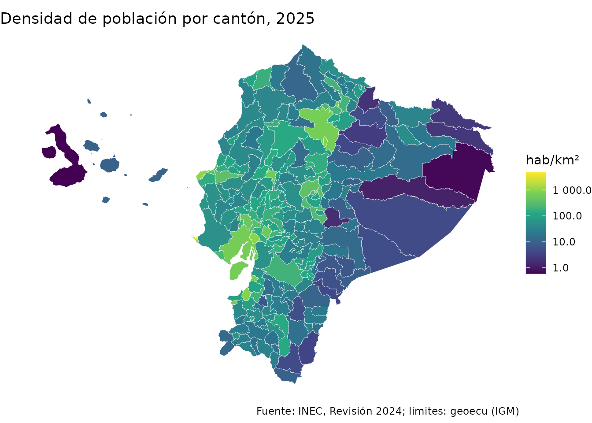
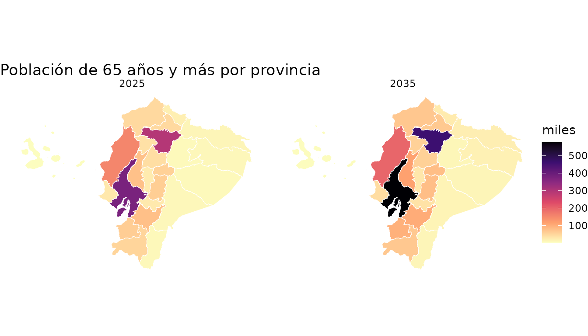

# Mapas de población con geoecu

pobecu y [geoecu](https://github.com/f-slg/geoecu) usan **los mismos
códigos DPA**. geoecu aporta los límites de provincias, cantones y
parroquias, y pobecu la población. Con
[`pob_mapa()`](https://f-slg.github.io/pobecu/reference/pob_mapa.md)
obtienes en una sola línea la capa `sf` con la población y la densidad,
lista para `ggplot2` o
[`plot()`](https://rdrr.io/r/graphics/plot.default.html).

``` r

library(pobecu)
library(ggplot2)
```

## Densidad cantonal

``` r

cant <- pob_mapa("canton", anio = 2025)
cant <- geoecu::reubicar_galapagos(cant)

ggplot(cant) +
  geom_sf(aes(fill = densidad), color = "white", linewidth = 0.1) +
  scale_fill_viridis_c(trans = "log10", name = "hab/km²",
                       labels = scales::label_number(big.mark = " ")) +
  labs(title = "Densidad de población por cantón, 2025",
       caption = "Fuente: INEC, Revisión 2024; límites: geoecu (IGM)") +
  theme_void()
```



## Parroquias: cabeceras y parroquias urbanas

geoecu dibuja por separado las parroquias urbanas, por ejemplo las 15 de
Cuenca, pero el Censo 2022 y pobecu las tratan como una sola unidad: la
cabecera cantonal. `pob_mapa("parroquia")` las fusiona automáticamente
con
[`agrupar_cabeceras()`](https://f-slg.github.io/pobecu/reference/agrupar_cabeceras.md):

``` r

cuenca <- pob_mapa("parroquia", anio = 2030, canton = "Cuenca")
#> Nota: las cifras parroquiales son una estimación de pobecu a partir de las proyecciones cantonales del INEC; no son cifras oficiales. Ver ?pob_parroquias. (Este aviso se muestra una vez por sesión.)
nrow(geoecu::read_parroquias(canton = "Cuenca"))  # parroquias en geoecu
#> [1] 36
nrow(cuenca)                                       # unidades del censo
#> [1] 22

ggplot(cuenca) +
  geom_sf(aes(fill = poblacion), color = "white") +
  scale_fill_gradient(low = "#FFF4D2", high = "#8C3B12", name = "habitantes",
                      trans = "log10") +
  labs(title = "Cuenca: población parroquial estimada, 2030") +
  theme_void()
```


## Tasas en el mapa

Para mapear una tasa, calcúlala con
[`pob_tasa()`](https://f-slg.github.io/pobecu/reference/pob_tasa.md) y
únela a la capa con
[`geoecu::geoecu_unir()`](https://rdrr.io/pkg/geoecu/man/geoecu_unir.html):

``` r

casos <- data.frame(dpa_canton = c("1101", "1102", "1103", "1104", "1110"),
                    anio = 2025, casos = c(130, 12, 25, 9, 6))
tasas <- pob_tasa(casos, "casos")
loja <- geoecu::geoecu_unir(tasas, codigo = "dpa_canton", nivel = "canton",
                            provincia = "Loja")

ggplot(loja) +
  geom_sf(aes(fill = tasa), color = "white") +
  scale_fill_distiller(palette = "OrRd", direction = 1, na.value = "grey90",
                       name = "por 100 000") +
  labs(title = "Tasa por 100 000 habitantes (datos de ejemplo)") +
  theme_void()
```


Si tus casos vienen con códigos de parroquias urbanas, conviértelos y
agrégalos antes de calcular la tasa:

``` r

casos_p <- data.frame(dpa_parroq = c("010101", "010102", "010151"),
                      anio = 2025, casos = c(4, 6, 1))
casos_p$dpa_parroq <- homologar_parroquia(casos_p$dpa_parroq)
casos_p <- aggregate(casos ~ dpa_parroq + anio, casos_p, sum)
pob_tasa(casos_p, "casos", nivel = "parroquia")
#>   dpa_parroq anio casos poblacion     tasa
#> 1     010150 2025    10    370641 2.698029
#> 2     010151 2025     1     23239 4.303111
```

## Varias desagregaciones: un mapa por grupo

Con sexo, edad o varios años, cada polígono se repite una vez por
combinación, lo que permite usar
[`facet_wrap()`](https://ggplot2.tidyverse.org/reference/facet_wrap.html):

``` r

mayores <- pob_mapa("provincia", anio = c(2025, 2035), edad = c(0, 65))
mayores <- geoecu::reubicar_galapagos(mayores[mayores$edad == "65+", ])

ggplot(mayores) +
  geom_sf(aes(fill = poblacion / 1000), color = "white", linewidth = 0.2) +
  facet_wrap(~anio) +
  scale_fill_viridis_c(name = "miles", option = "magma", direction = -1) +
  labs(title = "Población de 65 años y más por provincia") +
  theme_void()
```



## Nota sobre Puerto Ayora

La capa parroquial de geoecu no tiene el polígono de la cabecera del
cantón Santa Cruz (Galápagos), Puerto Ayora (`200350`).
`pob_mapa("parroquia")` avisa de ello: su población existe en pobecu,
pero no tiene dónde dibujarse.
