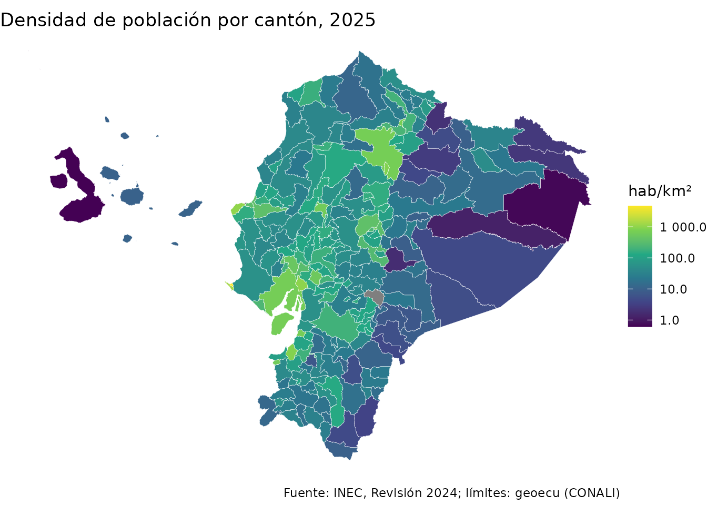
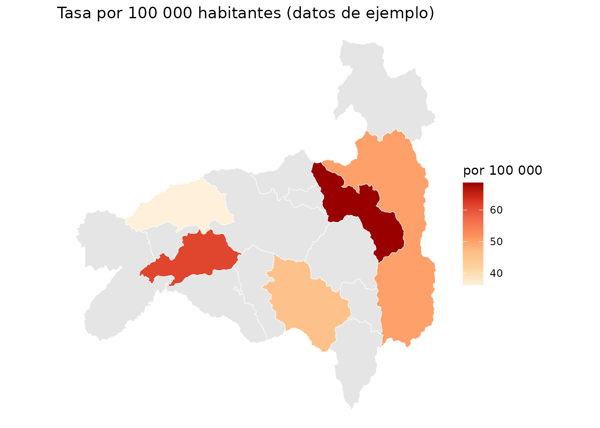
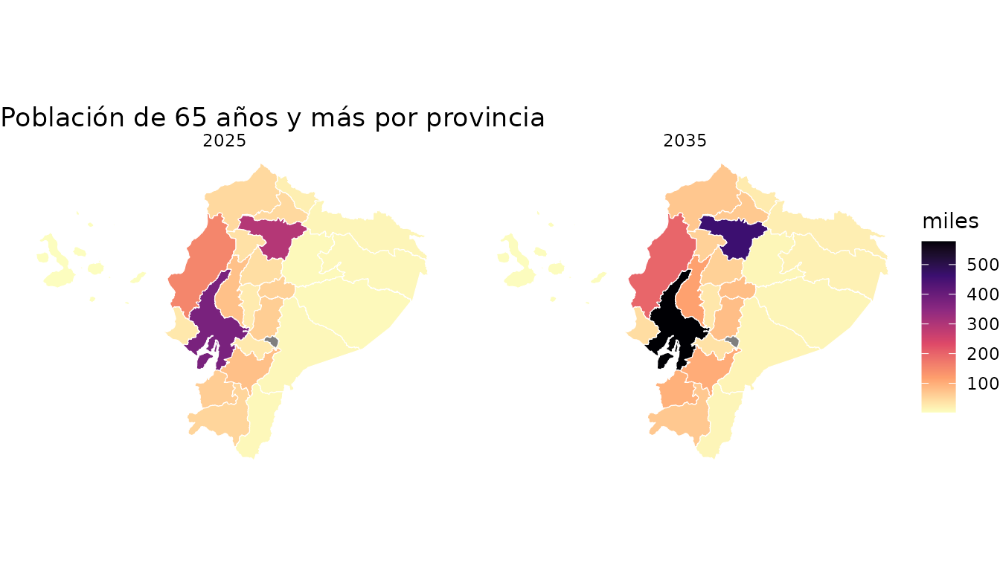

# Mapas de población con geoecu

pobecu y [geoecu](https://github.com/f-slg/geoecu) usan **los códigos
DPA**. geoecu 0.4.1 aporta límites y superficie `area_km2`, calculada
sobre el elipsoide WGS84 a partir de la geometría de resolución alta.
pobecu integra esa superficie con la población y calcula habitantes por
km² con
[`pob_mapa()`](https://f-slg.github.io/pobecu/reference/pob_mapa.md).

``` r

library(pobecu)
library(ggplot2)
```

## Dos divisiones territoriales

La población de pobecu usa las unidades del **Censo 2022**: 221 cantones
y 1042 parroquias (las proyecciones del INEC no tienen otras). geoecu,
desde la versión 0.4.0, usa la **Organización Territorial del Estado del
CONALI (2026)**, que es más reciente: 223 cantones y 1048 parroquias,
más 3 zonas en estudio. Las diferencias son pocas, pero importan en un
mapa:

| CONALI 2026 (geoecu) | Censo 2022 (pobecu) |
|----|----|
| Cantón Borbón (`0809`) y sus 12 parroquias | Parte de Eloy Alfaro (`0802`) |
| Cantón Sevilla Don Bosco (`1413`, cabecera `141350`) | Parroquia rural de Morona (`140157`) |
| Bella Vista (`200351`) | Bella Vista (`200353`) |
| Sosote (`131251`) | Dentro de Rocafuerte (`131250`) |
| Shuar Pastaza (`160167`) | Dentro de Simón Bolívar (`160162`) |
| Juan Montalvo (`170257`) | Dentro de Cayambe (`170250`) |
| La Magdalena, La Primavera, Miss Ecuador (`210456` a `210458`) | Dentro de Shushufindi (`210450`) |
| Zonas en estudio (`139090`, `140190`, `900651`) | Sin población propia |

[`pob_mapa()`](https://f-slg.github.io/pobecu/reference/pob_mapa.md)
convierte la capa a las unidades del censo con
[`agrupar_unidades()`](https://f-slg.github.io/pobecu/reference/agrupar_unidades.md)
antes de unirla, así que cada cifra se dibuja sobre el territorio que le
corresponde. Si dibujaras la población de Eloy Alfaro solo sobre el
polígono que hoy tiene ese cantón (465 km² de los 4480 que tenía en el
censo), su densidad saldría casi diez veces más alta.

``` r

esmeraldas <- geoecu::read_cantones(provincia = "Esmeraldas")
nrow(esmeraldas)                    # cantones en geoecu
#> [1] 8
nrow(agrupar_unidades(esmeraldas))  # cantones del censo
#> [1] 7
```

## Densidad cantonal: habitantes por superficie

[`pob_mapa()`](https://f-slg.github.io/pobecu/reference/pob_mapa.md)
agrupa las unidades CONALI que corresponden a cada unidad del Censo 2022
y suma las áreas de sus polígonos. Así numerador y denominador
corresponden al mismo territorio. La fórmula es `poblacion / area_km2`.

``` r

cant <- pob_mapa("canton", anio = 2025)
cant <- geoecu::reubicar_galapagos(cant)
sf::st_drop_geometry(cant)[, c("canton", "poblacion", "area_km2", "densidad")]
#>                                        canton poblacion  area_km2     densidad
#> 1                                      Cuenca    624053  3194.613  195.3454143
#> 2                                       Girón     12423   342.431   36.2788416
#> 3                                    Gualaceo     44426   345.894  128.4381920
#> 4                                       Nabón     14868   631.367   23.5489026
#> 5                                       Paute     27349   267.669  102.1747008
#> 6                                      Pucará      9750   638.841   15.2620136
#> 7                                San Fernando      3726   143.124   26.0333697
#> 8                                Santa Isabel     20785   826.950   25.1345305
#> 9                                      Sígsig     25756   676.689   38.0617980
#> 10                                        Oña      3482   289.751   12.0172148
#> 11                                  Chordeleg     12359   104.275  118.5231359
#> 12                                     El Pan      2755   139.198   19.7919510
#> 13                             Sevilla De Oro      4565   315.030   14.4906834
#> 14                                 Guachapala      3656    40.476   90.3251309
#> 15                      Camilo Ponce Enríquez     25005   214.214  116.7290653
#> 16                                   Guaranda    100355  1859.500   53.9688088
#> 17                                  Chillanes     20280   669.999   30.2687019
#> 18                                     Chimbo     15548   269.775   57.6332129
#> 19                                  Echeandía     15511   244.901   63.3357969
#> 20                                 San Miguel     28800   585.847   49.1595929
#> 21                                     Caluma     16509   175.516   94.0598008
#> 22                                  Las Naves      7348   150.202   48.9207867
#> 23                                    Azogues     77819   632.754  122.9846038
#> 24                                    Biblián     18828   182.073  103.4090722
#> 25                                      Cañar     52160  1855.039   28.1180072
#> 26                                 La Troncal     68127   367.466  185.3967442
#> 27                                   El Tambo      9643    63.074  152.8839141
#> 28                                      Déleg      6255    73.553   85.0407189
#> 29                                     Suscal      4628    53.292   86.8423028
#> 30                                     Tulcán     95087  1811.553   52.4892178
#> 31                                    Bolívar     16368   358.948   45.5999198
#> 32                                     Espejo     14593   566.508   25.7595656
#> 33                                       Mira     12859   583.233   22.0477922
#> 34                                   Montúfar     30165   379.711   79.4419967
#> 35                         San Pedro De Huaca      7948    76.279  104.1964368
#> 36                                  Latacunga    230875  1494.010  154.5337715
#> 37                                    La Maná     57972   660.519   87.7673466
#> 38                                     Pangua     22719   719.390   31.5809227
#> 39                                     Pujilí     68269  1328.491   51.3883797
#> 40                                    Salcedo     70344   468.055  150.2900300
#> 41                                  Saquisilí     24780   156.286  158.5554688
#> 42                                    Sigchos     18423  1357.086   13.5754108
#> 43                                   Riobamba    272762   997.860  273.3469625
#> 44                                     Alausí     37948  1100.137   34.4938858
#> 45                                      Colta     29956   819.057   36.5737671
#> 46                                     Chambo     13811   166.012   83.1927812
#> 47                                    Chunchi     10750   272.525   39.4459224
#> 48                                    Guamote     35934  1192.883   30.1236584
#> 49                                      Guano     49528   464.820  106.5530743
#> 50                                 Pallatanga     12137   379.908   31.9472083
#> 51                                     Penipe      6909   370.680   18.6387180
#> 52                                    Cumandá     17620   159.418  110.5270421
#> 53                                    Machala    324062   372.498  869.9697716
#> 54                                  Arenillas     33996   787.735   43.1566453
#> 55                                  Atahualpa      6221   281.764   22.0787609
#> 56                                     Balsas      8179    68.785  118.9067384
#> 57                                     Chilla      2256   331.744    6.8004244
#> 58                                   El Guabo     63789   580.164  109.9499452
#> 59                                 Huaquillas     59997    98.717  607.7676591
#> 60                                  Marcabelí      7152   148.518   48.1557791
#> 61                                     Pasaje     87122   456.278  190.9406108
#> 62                                      Piñas     30236   614.688   49.1891822
#> 63                                  Portovelo     14002   284.172   49.2729755
#> 64                                 Santa Rosa     85112   896.363   94.9526029
#> 65                                     Zaruma     24982   651.948   38.3190070
#> 66                                  Las Lajas      5930   298.819   19.8447890
#> 67                                 Esmeraldas    232221  1346.422  172.4726720
#> 68                                Eloy Alfaro     52040  4477.300   11.6230764
#> 69                                     Muisne     38966  1267.049   30.7533489
#> 70                                   Quinindé    134131  3621.426   37.0381723
#> 71                                San Lorenzo     55584  3097.500   17.9447942
#> 72                                   Atacames     55990   510.634  109.6480062
#> 73                                   Rioverde     36445  1513.245   24.0840049
#> 74                                  Guayaquil   2982756  4493.087  663.8544947
#> 75           Alfredo Baquerizo Moreno (Jujan)     26554   228.441  116.2400795
#> 76                                      Balao     28057   439.022   63.9079591
#> 77                                     Balzar     62813  1176.833   53.3746080
#> 78                                    Colimes     27870   757.758   36.7795523
#> 79                                      Daule    246208   511.474  481.3695320
#> 80                                      Durán    332968   341.991  973.6162648
#> 81                                 El Empalme     87521   649.282  134.7965907
#> 82                                 El Triunfo     65252   560.308  116.4573770
#> 83                                    Milagro    217302   399.102  544.4773517
#> 84                                   Naranjal     92986  1701.925   54.6357801
#> 85                                  Naranjito     48219   230.749  208.9673195
#> 86                                  Palestina     19171   186.509  102.7886054
#> 87                                Pedro Carbo     56925   941.169   60.4832926
#> 88                                Samborondón    109253   344.027  317.5710046
#> 89                                Santa Lucía     46729   365.146  127.9734681
#> 90                                    Salitre     65565   393.407  166.6594646
#> 91                    San Jacinto De Yaguachi     78831   530.649  148.5558250
#> 92                                     Playas     66818   270.181  247.3082859
#> 93                              Simón Bolívar     31768   290.478  109.3645646
#> 94                Coronel Marcelino Maridueña     14307   254.131   56.2977362
#> 95                       Lomas De Sargentillo     24674    71.874  343.2952111
#> 96                                      Nobol     26732   134.749  198.3836615
#> 97                   General Antonio Elizalde     13012   141.438   91.9979072
#> 98                               Isidro Ayora     15866   492.126   32.2397110
#> 99                                     Ibarra    230846  1137.209  202.9934691
#> 100                              Antonio Ante     56725    79.794  710.8930496
#> 101                                 Cotacachi     56779  1863.428   30.4701872
#> 102                                   Otavalo    121046   530.470  228.1863253
#> 103                                 Pimampiro     14151   438.920   32.2404994
#> 104                     San Miguel De Urcuquí     18593   735.328   25.2853149
#> 105                                      Loja    258514  1890.991  136.7082128
#> 106                                    Calvas     26374   851.174   30.9854389
#> 107                                  Catamayo     36428   651.854   55.8836795
#> 108                                    Celica     14676   521.863   28.1223233
#> 109                              Chaguarpamba      6875   313.313   21.9429133
#> 110                                 Espíndola     14277   516.265   27.6544023
#> 111                                 Gonzanamá     12421   681.951   18.2139186
#> 112                                    Macará     18520   573.283   32.3051617
#> 113                                    Paltas     22929  1156.543   19.8254626
#> 114                                   Puyango     16559   637.330   25.9818304
#> 115                                  Saraguro     29588  1084.797   27.2751492
#> 116                                 Sozoranga      6917   422.024   16.3900631
#> 117                                 Zapotillo     15333  1212.375   12.6470770
#> 118                                    Pindal     10987   202.118   54.3593346
#> 119                                  Quilanga      3925   236.525   16.5944403
#> 120                                    Olmedo      4134   113.798   36.3275277
#> 121                                  Babahoyo    193677  1070.985  180.8400678
#> 122                                      Baba     48446   515.494   93.9797553
#> 123                                  Montalvo     30483   355.216   85.8153912
#> 124                               Puebloviejo     45833   334.303  137.1001756
#> 125                                   Quevedo    227098   378.843  599.4514878
#> 126                                  Urdaneta     35472   384.807   92.1812753
#> 127                                  Ventanas     79831   512.767  155.6866959
#> 128                                    Vinces     86908   711.559  122.1374475
#> 129                                  Palenque     25911   569.392   45.5064349
#> 130                                  Buena Fe     83670   581.290  143.9384817
#> 131                                  Valencia     56350   969.729   58.1090181
#> 132                                   Mocache     44163   565.691   78.0691225
#> 133                                Quinsaloma     20645   288.877   71.4664027
#> 134                                Portoviejo    345349   957.268  360.7652194
#> 135                                   Bolívar     45910   523.842   87.6409299
#> 136                                     Chone    136807  3063.290   44.6601530
#> 137                                 El Carmen    132569  1741.049   76.1431758
#> 138                             Flavio Alfaro     29175  1347.048   21.6584710
#> 139                                  Jipijapa     82465  1476.730   55.8429774
#> 140                                     Junín     23645   267.123   88.5172748
#> 141                                     Manta    291322   282.608 1030.8342297
#> 142                               Montecristi    108345   705.583  153.5538696
#> 143                                     Paján     44409  1100.519   40.3527790
#> 144                                 Pichincha     31960  1074.993   29.7304262
#> 145                                Rocafuerte     46005   278.696  165.0723369
#> 146                                 Santa Ana     53941  1019.709   52.8984249
#> 147                                     Sucre     68301   693.440   98.4959045
#> 148                                   Tosagua     45153   381.543  118.3431487
#> 149                                24 De Mayo     32936   546.548   60.2618617
#> 150                                Pedernales     80838  1970.295   41.0283739
#> 151                                    Olmedo     10582   257.046   41.1677287
#> 152                              Puerto López     28448   429.652   66.2117248
#> 153                                      Jama     17363   568.445   30.5447317
#> 154                                  Jaramijó     32971    96.607  341.2899686
#> 155                               San Vicente     26563   737.289   36.0279348
#> 156          ZONA EN ESTUDIO "JARAMIJO-MANTA"        NA     7.705           NA
#> 157                                    Morona     59992  4359.688   13.7606177
#> 158                                Gualaquiza     23497  2159.014   10.8832087
#> 159                             Limón Indanza     10118  1828.031    5.5349171
#> 160                                    Palora     13100  1448.530    9.0436511
#> 161                                  Santiago     10001  1365.969    7.3215424
#> 162                                     Sucúa     24940  1194.520   20.8786793
#> 163                                  Huamboya     11987   654.208   18.3229187
#> 164                            San Juan Bosco      4550  1088.854    4.1787053
#> 165                                    Taisha     30773  6116.879    5.0308335
#> 166                                   Logroño      8030  1176.697    6.8241867
#> 167                               Pablo Sexto      2419  1386.913    1.7441613
#> 168                                  Tiwintza     10468  1178.285    8.8840985
#> 169                                      Tena     86688  3898.833   22.2343455
#> 170                                 Archidona     32667  3050.744   10.7078798
#> 171                                  El Chaco      9585  3475.126    2.7581734
#> 172                                    Quijos      6673  1588.805    4.2000120
#> 173               Carlos Julio Arosemena Tola      4885   499.571    9.7783899
#> 174                                   Pastaza     89381 19854.830    4.5017258
#> 175                                      Mera     15960   530.460   30.0870942
#> 176                               Santa Clara      4743   312.080   15.1980261
#> 177                                   Arajuno     10848  8816.322    1.2304451
#> 178           Distrito Metropolitano De Quito   2856667  4196.306  680.7575520
#> 179                                   Cayambe    113328  1199.071   94.5131689
#> 180                                     Mejía    108478  1409.820   76.9445745
#> 181                             Pedro Moncayo     43669   334.320  130.6203637
#> 182                                 Rumiñahui    114467   135.281  846.1424738
#> 183                  San Miguel De Los Bancos     14120   854.979   16.5150255
#> 184                   Pedro Vicente Maldonado     16620   618.381   26.8766343
#> 185                              Puerto Quito     27129   695.605   39.0005822
#> 186                                    Ambato    383053  1021.548  374.9730801
#> 187                       Baños De Agua Santa     22824  1066.868   21.3934620
#> 188                                  Cevallos     11044    18.763  588.6052337
#> 189                                     Mocha      7418    85.147   87.1199220
#> 190                                    Patate     14070   292.247   48.1442068
#> 191                                     Quero     19354   169.015  114.5105464
#> 192                      San Pedro De Pelileo     66129   199.392  331.6532258
#> 193                       Santiago De Píllaro     43647   469.449   92.9749557
#> 194                                   Tisaleo     14303    59.589  240.0275219
#> 195                                    Zamora     32050  1900.177   16.8668498
#> 196                                 Chinchipe     10952  1101.727    9.9407566
#> 197                                Nangaritza      7220  2020.602    3.5731925
#> 198                                  Yacuambi      6603  1252.864    5.2703246
#> 199                                  Yantzaza     25082  1012.829   24.7642988
#> 200                                 El Pangui     14366   630.931   22.7695263
#> 201                      Centinela Del Cóndor      8260   260.010   31.7680089
#> 202                                   Palanda      9134  2041.538    4.4740779
#> 203                                  Paquisha      5269   339.573   15.5165458
#> 204                             San Cristóbal      8883   831.486   10.6832827
#> 205                                   Isabela      3253  5356.747    0.6072715
#> 206                                Santa Cruz     18129  1805.363   10.0417478
#> 207                                Lago Agrio    107841  3136.521   34.3823619
#> 208                           Gonzalo Pizarro     10610  2238.898    4.7389385
#> 209                                  Putumayo      8901  3524.282    2.5256208
#> 210                               Shushufindi     52747  2491.990   21.1666178
#> 211                                 Sucumbíos      3111  1513.041    2.0561241
#> 212                                  Cascales     11796  1257.546    9.3801738
#> 213                                  Cuyabeno      9115  3836.043    2.3761465
#> 214                     Francisco De Orellana    101643  7049.267   14.4189460
#> 215                                  Aguarico      7574 11212.372    0.6755038
#> 216                     La Joya De Los Sachas     56383  1196.391   47.1275695
#> 217                                    Loreto     30420  2143.552   14.1913982
#> 218                             Santo Domingo    471217  3454.510  136.4063210
#> 219                              La Concordia     57292   324.346  176.6385280
#> 220                               Santa Elena    198016  3598.049   55.0342700
#> 221                               La Libertad    118743    25.290 4695.2550415
#> 222                                   Salinas     90188    67.839 1329.4417665
#> 223 ZONA EN ESTUDIO: JUVAL (CAÑAR-CHIMBORAZO)        NA   605.651           NA

ggplot(cant) +
  geom_sf(aes(fill = densidad), color = "white", linewidth = 0.1) +
  scale_fill_viridis_c(trans = "log10", name = "hab/km²",
                       labels = scales::label_number(big.mark = " ")) +
  labs(title = "Densidad de población por cantón, 2025",
       caption = "Fuente: INEC, Revisión 2024; límites: geoecu (CONALI)") +
  theme_void()
```



La densidad es un promedio en la superficie completa del cantón; no
describe la distribución de habitantes dentro del polígono. Las zonas en
estudio conservan `NA`. Las áreas de residencia urbana y rural no tienen
geometrías propias en pobecu.

## Parroquias

Las cabeceras cantonales (código terminado en `50`) incluyen a todas las
parroquias urbanas del cantón, igual en el censo que en geoecu 0.4.0.
Con geoecu 0.3.0 y anteriores, que dibujaban las parroquias urbanas por
separado (por ejemplo, las 15 de Cuenca), `pob_mapa("parroquia")` las
fusiona en su cabecera.

``` r

cuenca <- pob_mapa("parroquia", anio = 2030, canton = "Cuenca")
#> Nota: las cifras parroquiales son una estimación de pobecu a partir de las proyecciones cantonales del INEC; no son cifras oficiales. Ver ?pob_parroquias. (Este aviso se muestra una vez por sesión.)

ggplot(cuenca) +
  geom_sf(aes(fill = poblacion), color = "white") +
  scale_fill_gradient(low = "#FFF4D2", high = "#8C3B12", name = "habitantes",
                      trans = "log10") +
  labs(title = "Cuenca: población parroquial estimada, 2030") +
  theme_void()
```



## Tasas en el mapa

Para mapear una tasa, calcúlala con
[`pob_tasa()`](https://f-slg.github.io/pobecu/reference/pob_tasa.md) y
únela a la capa con
[`geoecu::geoecu_unir()`](https://f-slg.github.io/geoecu/reference/geoecu_unir.html):

``` r

casos <- data.frame(dpa_canton = c("1101", "1102", "1103", "1104", "1110"),
                    anio = 2025, casos = c(130, 12, 25, 9, 6))
tasas <- pob_tasa(casos, "casos")
loja <- geoecu::geoecu_unir(tasas, codigo = "dpa_canton", nivel = "canton",
                            provincia = "Loja")

ggplot(loja) +
  geom_sf(aes(fill = tasa), color = "white") +
  scale_fill_distiller(palette = "OrRd", direction = 1, na.value = "grey90",
                       name = "por 100 000") +
  labs(title = "Tasa por 100 000 habitantes (datos de ejemplo)") +
  theme_void()
```


Si tus casos usan los códigos de geoecu 0.4.0 (CONALI 2026) o de
parroquias urbanas, conviértelos a las unidades del censo con
[`homologar_canton()`](https://f-slg.github.io/pobecu/reference/homologar_canton.md)
o
[`homologar_parroquia()`](https://f-slg.github.io/pobecu/reference/homologar_parroquia.md)
y agrégalos antes de calcular la tasa. Después, para mapearla, usa la
capa convertida con
[`agrupar_unidades()`](https://f-slg.github.io/pobecu/reference/agrupar_unidades.md):

``` r

casos_e <- data.frame(dpa_canton = c("0802", "0809", "0801"),
                      anio = 2025, casos = c(7, 5, 30))
casos_e$dpa_canton <- homologar_canton(casos_e$dpa_canton)  # Borbón -> Eloy Alfaro
casos_e <- aggregate(casos ~ dpa_canton + anio, casos_e, sum)
tasas_e <- pob_tasa(casos_e, "casos")

capa <- agrupar_unidades(geoecu::read_cantones(provincia = "Esmeraldas"))
mapa_e <- merge(capa, tasas_e[, c("dpa_canton", "tasa")], all.x = TRUE)

casos_p <- data.frame(dpa_parroq = c("131250", "131251", "131252"),
                      anio = 2025, casos = c(4, 2, 1))
casos_p$dpa_parroq <- homologar_parroquia(casos_p$dpa_parroq)  # Sosote -> Rocafuerte
casos_p <- aggregate(casos ~ dpa_parroq + anio, casos_p, sum)
pob_tasa(casos_p, "casos", nivel = "parroquia")
#> Warning: 1 fila(s) sin población (código, año u otra desagregación no
#> encontrados).
#>   dpa_parroq anio casos poblacion     tasa
#> 1     131250 2025     6     46005 13.04206
#> 2     131252 2025     1        NA       NA
```

## Varias desagregaciones: un mapa por grupo

Con sexo, edad o varios años, cada polígono se repite una vez por
combinación, lo que permite usar
[`facet_wrap()`](https://ggplot2.tidyverse.org/reference/facet_wrap.html):

``` r

mayores <- pob_mapa("provincia", anio = c(2025, 2035), edad = c(0, 65))
mayores <- geoecu::reubicar_galapagos(mayores[mayores$edad == "65+", ])

ggplot(mayores) +
  geom_sf(aes(fill = poblacion / 1000), color = "white", linewidth = 0.2) +
  facet_wrap(~anio) +
  scale_fill_viridis_c(name = "miles", option = "magma", direction = -1) +
  labs(title = "Población de 65 años y más por provincia") +
  theme_void()
```



## Zonas en estudio

Las capas de geoecu incluyen tres zonas en estudio, territorios con
límites aún no resueltos, para que el mapa nacional no tenga huecos. No
tienen población propia en pobecu, así que
[`pob_mapa()`](https://f-slg.github.io/pobecu/reference/pob_mapa.md) las
devuelve con `poblacion = NA`; `ggplot2` las dibuja con el color de
`na.value`.

Con geoecu 0.3.0, la capa parroquial no tenía el polígono de Puerto
Ayora (`200350`) y `pob_mapa("parroquia")` lo avisaba; geoecu 0.4.0 ya
lo incluye.
